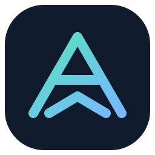
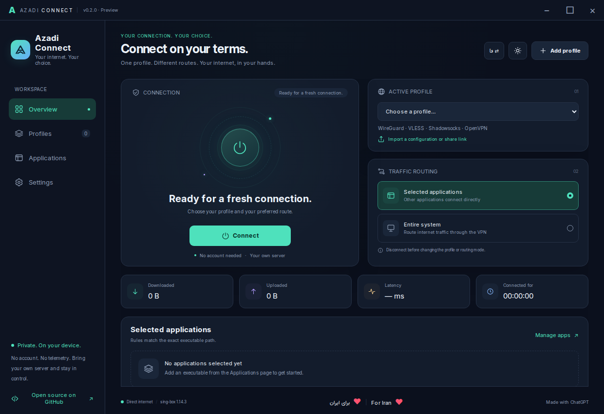
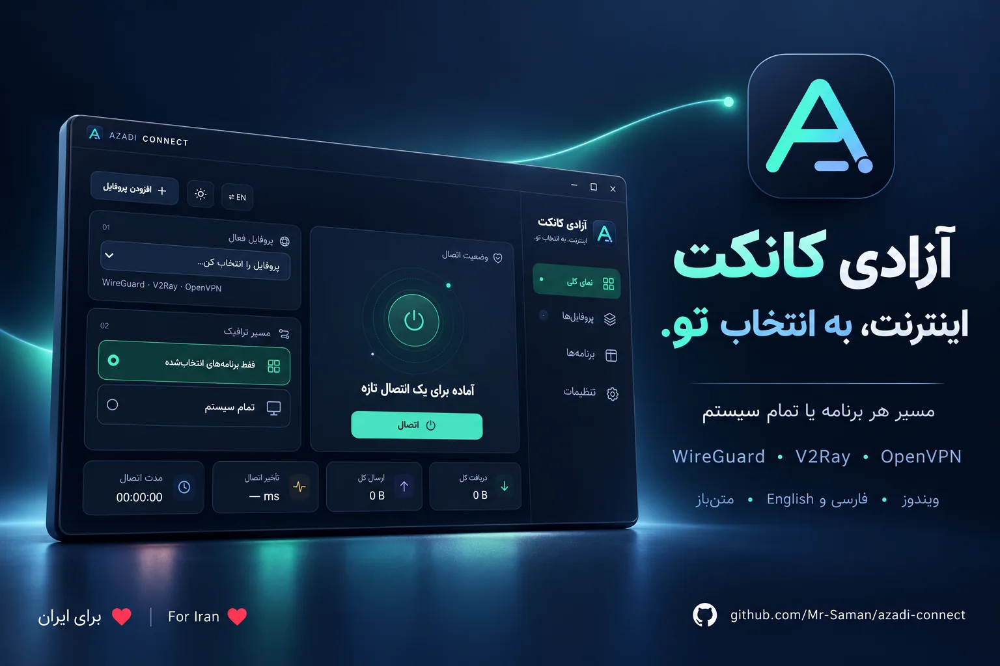
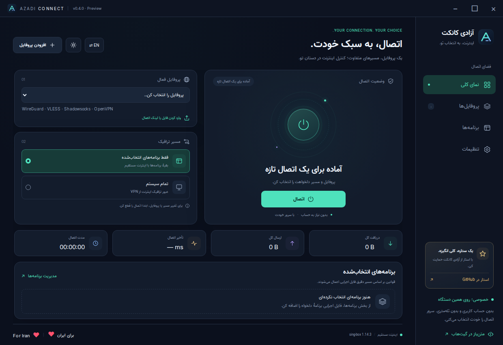

<div align="center">



# Azadi Connect · آزادی کانکت

### Your connection. Your choice. 🌐

**A local-first, bilingual Windows VPN client with application routing.**

🇮🇷 **برای ایران ❤️ · For Iran ❤️**

**Windows 10/11 x64** · **فارسی / English** · **GPL-3.0-or-later** · **v0.5.0 Preview**

[English guide](#english) · [راهنمای فارسی](#فارسی) · [Architecture](docs/ARCHITECTURE.md) · [Security](SECURITY.md) · [Contributing](CONTRIBUTING.md)

</div>

---

## English

[](https://github.com/Mr-Saman/azadi-connect)

**Enjoy the project? Tap ⭐ Star at the top of this repository. Your support helps others find it.**



*Disconnected interface preview. Screenshots do not represent a live VPN session.*

### ✨ What is Azadi Connect?

Azadi Connect brings your own VPN profiles into one desktop interface. Choose individual Windows applications, or route the entire system through your selected connection. Switch between English/LTR and Persian/RTL instantly, with bundled Inter and Vazir fonts and no CDN dependencies.

> 🤖 **This project was generated entirely with ChatGPT**, including the application code, interface design, documentation and build scripts. Independent third-party software—including sing-box, Electron and the fonts—belongs to its original authors and is credited in [THIRD_PARTY_NOTICES.md](THIRD_PARTY_NOTICES.md).

### ✨ New in the development branch

| Feature | What you get |
| --- | --- |
| In-app updates | Automatic release check after startup, manual check, download progress, SHA-256 verification, then an explicit installation action |
| Session timer | Disconnect in 15, 30, 60 or 120 minutes; cancel any time while connected |
| Floating notifications | Queued, dismissible success/error messages with screen-reader announcements |
| Safer controls | Profile editing is disabled while protection is active; unknown network-lock state blocks new connections |

These changes target the 0.5.0 Windows release; download availability depends on the Windows build and release publication. Existing **0.4.1** installers do not gain them until a new build is installed.

### 🔄 Update without visiting GitHub

Open **Settings → Update center**. Packaged Windows builds also check for a new stable release 15 seconds after launch. Choose **Download update**, wait for verification, then **Install and restart**. Disconnect and use **Restore direct Internet** first if the persistent network lock is armed. Windows may request administrator approval.

The app downloads the official full installer itself; you do not need to open GitHub or download it manually. This is **not a delta update or a silent background install**. It uses GitHub's latest stable release API and the release's `SHA256SUMS.txt`. The version, repository URL, exact asset name, size and SHA-256 must match; the file is checked again before launch. Failed downloads never become installable. Checksums protect integrity; they are not a substitute for publisher code signing. The preview remains unsigned.

Release maintainers must publish a stable tag matching `package.json` and attach both `Azadi-Connect-VERSION-Windows-x64-Setup.exe` and `SHA256SUMS.txt` via the Windows release workflow. API rate limits, network restrictions, or missing release assets are reported as update failures. Update traffic uses `api.github.com`, `github.com` and GitHub's release download infrastructure. Profiles stay in the existing encrypted local vault.

### ⏱️ Time-limited sessions

After connecting, open **Settings → Disconnect timer** and choose a duration. A countdown shows remaining minutes. Choose **No timer** to cancel. The deadline runs in the main process, checks elapsed time after sleep, and is cleared on disconnect, connection failure or app exit. Timers are not restored after restarting the app. Automatic disconnect **does not release Kill Switch protection**; use **Restore direct Internet** when you want ordinary Internet access again.

### 🪟 Install on Windows

1. Open this repository’s **Releases** page and download `Azadi-Connect-0.5.0-Windows-x64-Setup.exe` from the [latest release](https://github.com/Mr-Saman/azadi-connect/releases/tag/v0.5.0).
2. Run the installer and accept the Windows Administrator/UAC request. The installer supports reinstall/upgrade over an existing installation and preserves your profiles. Its finish page offers **Run Azadi Connect** (checked by default) and **Show shortcut to pin to Start or taskbar**.
3. Open **Azadi Connect → Add profile**. Import your configuration, or paste a share link.
4. Choose **Selected applications** and add the actual `.exe` paths, or choose **Entire system**.
5. Click **Connect**. A connection is marked verified only after a request through the VPN outbound succeeds.

🔐 Profiles are encrypted for the current Windows account with DPAPI. They are never committed, uploaded to GitHub or sent to an Azadi service. You supply your own functioning server; this project does not provide free VPN servers or accounts.

**Release status:** this is an unsigned preview. Windows can display an unknown-publisher notice. The source and SHA-256 checksums are provided for inspection; there is no claim of independent security auditing. Windows routing, DNS and real-provider compatibility still require testing on your own device. An existing WireGuard/OpenVPN client is not required for supported imports; the engine is bundled.

**Updating or reinstalling:** run the new installer over the existing installation. From 0.4 onward, the installer requests an orderly shutdown of a running copy. For 0.3 and earlier, choose **Quit** from the tray menu, then **Retry** in the installer; closing the window only hides it. Profiles and existing persistent protection are preserved. Old app-mode filters are migrated atomically when the new app opens.

**Pin to Start/taskbar:** choose the finish-page shortcut option, or **Settings → Shortcuts & pinning → Show shortcut to pin**. Right-click **Azadi Connect.lnk** and select **Pin to Start** or **Pin to taskbar**. Windows owns that final choice; Windows 11 may put it under **Show more options**.

### 🧩 Supported imports

| Protocol / format | Import | Selected apps | Entire system | Scope |
| --- | --- | --- | --- | --- |
| WireGuard | `.conf` or configuration text | ✅ | ✅ | Multiple peers, IPv4/IPv6 endpoints, keys, DNS, MTU, keepalive and AllowedIPs |
| VLESS / Reality | `vless://` | ✅ | ✅ | TCP, WebSocket, gRPC, HTTPUpgrade; Reality and TLS |
| VMess | `vmess://` JSON-base64 | ✅ | ✅ | Modern `alterId=0`; supported transports only |
| Shadowsocks | `ss://` | ✅ | ✅ | SIP002 and full-base64 links; no external plugins |
| Trojan | `trojan://` | ✅ | ✅ | TLS and supported transports |
| Hysteria2 | `hysteria2://`, `hy2://` | ✅ | ✅ | TLS; optional Salamander obfuscation |
| TUIC | `tuic://` | ✅ | ✅ | UUID/password profiles with TLS |
| OpenVPN | `.ovpn` or configuration text | ✅ | ✅ | TLS/TUN, inline CA/certificate/key and optional username/password |
| SOCKS5 / HTTP(S) | Share links | ✅ | ✅* | Upstream-dependent protocol support; HTTP cannot carry arbitrary UDP |
| Offline list | `.txt` or pasted lines/base64 | ✅ | ✅ | 1–200 supported share links per import |

✅ means an implemented importer and routing path, validated against the pinned core’s configuration checker. It does **not** mean every provider, authentication method or network has passed a live interoperability test. See [VALIDATION.md](docs/VALIDATION.md).

\* SOCKS and plain HTTP do not inherently encrypt your traffic. Unsupported upstream traffic fails rather than being deliberately sent direct by a fallback rule.

**Explicitly unsupported:** raw V2Ray/Xray/sing-box/Clash JSON or YAML, remote subscription fetching, XHTTP, legacy VMess headers/alterId, Shadowsocks plugins, OpenVPN TAP/MFA/encrypted private keys/external file references, scripts and plugins, proprietary VPN clients, IPsec and arbitrary “VPN extensions.” Unsupported options produce an error; no imported shell hooks are executed. Some non-security OpenVPN options such as verbosity and reconnect hints are intentionally ignored; see the importer source for the exact allowlist.

### 🎛️ Two routing modes

- **Selected applications:** exact executable-path rules go through the VPN. Other application traffic is forwarded directly. Add helper executables separately where an app uses them. Close old app connections after changing routing.
- **Entire system:** the default outbound is the VPN for traffic captured by the TUN interface, including IPv4 and IPv6. WireGuard `AllowedIPs` are preserved; a private-network-only profile cannot become a full internet VPN by changing the UI switch.

**WireGuard compatibility:** IPv4 peers with an automatic source port use a connected UDP transport without opening an unnecessary IPv6 socket. Peer hostnames stay inside the core’s bootstrap resolver, including when a persistent system lock is active. On IPv4-only networks, hostname peers use A records and the UDP4 client transport; saved keys, tunnel addresses and AllowedIPs are preserved. IPv6-only peer endpoints still need a working native IPv6 path. On networks without a physical IPv6 default route, unrelated TUN IPv6 fails quickly so apps can retry IPv4; selected IPv6 stays inside the VPN.

**Connection check:** two HTTPS targets are tried through the VPN output, starting with a literal IPv4 Cloudflare address to avoid a Google/DNS single point of failure. Both failing still produces `healthFailed`; a running engine alone is never reported as connected.

**DNS policy:** in **selected-app mode**, shared Windows DNS stays on the normal LAN/Wi-Fi resolver, so unrelated applications remain online when the VPN is unavailable. The TUN does not replace adapter DNS or intercept all DNS; the engine also bootstraps server names using the existing network resolver. An app’s own DNS/DoH follows its executable route. Shared Windows DNS for selected apps is also direct in this mode. In **entire-system mode**, ordinary DNS uses a WireGuard profile’s first DNS IP or Cloudflare DNS-over-TLS through the VPN, with direct `1.1.1.1` bootstrap. This is not a promise of absolute leak prevention.

**🛡️ Optional Kill Switch:** enable it in Settings before connecting. Persistent Windows Filtering Platform rules block direct traffic for the selected executables or the whole system. The lock stays after disconnect, quit or core/app failure. Use **Restore direct Internet**, the tray recovery action, or **Start → Azadi Connect → Restore Internet** to release it. App mode protects only selected executables; it leaves unrelated traffic and shared Windows DNS on the normal network. See the [scope and recovery guide](docs/KILL_SWITCH.md). This preview is not an independently audited privacy product.

### 💎 Included features

- 🌗 Dark and light themes, locally bundled fonts and original vector icons.
- 🗂️ Multiple profiles, active-profile selection and offline batch imports.
- 🧭 Executable picker and a searchable list of running Windows applications with their executable icons. Missing icons fall back to an initial.
- 🔒 DPAPI profile vault, restricted runtime directory ACLs and pinned engine integrity checks.
- 🛡️ Sandboxed renderer, narrow IPC bridge, denied navigation and remote network requests.
- 🛡️ Optional persistent Kill Switch with explicit Internet recovery.
- 🩺 Persistent, copyable connection diagnostics with credential redaction.
- 💓 Actual outbound connectivity check before showing a verified connection.
- 📊 Session upload/download totals, latency and connection duration.
- 🪟 Tray menu, single-instance behavior and orderly disconnect on Quit.
- 🧰 A native Windows Job Object guardian closes the engine when its parent exits.
- 📦 Reproducible build instructions, versioned commits and a Windows release workflow.

### 🛠️ Build from source

Requirements: **Windows 10/11 x64**, **Node.js 24+**, npm, Git and **Visual Studio Build Tools with Desktop development with C++**. Use a **Developer Command Prompt for VS** so `cl.exe` is on PATH. Internet is needed to obtain dependencies and the pinned upstream engine during the build; the installed UI loads its assets locally.

```powershell
git clone https://github.com/Mr-Saman/azadi-connect.git
cd azadi-connect
npm ci
npm test
npm run assets
npm run build:guardian
npm run check:engine
npm start
```

To create the installable Windows EXE:

```powershell
npm run build:win
```

Output: `dist/Azadi-Connect-0.5.0-Windows-x64-Setup.exe`.

The download script pins **sing-box 1.14.3** and its official archive SHA-256. It never silently selects “latest.” The native guardian is compiled from the included C source, then its hash is recorded. The application rechecks both binaries before connecting. Installer branding, version information and the Administrator manifest are embedded with a JavaScript PE resource editor; Wine is not required for packaging on Linux.

For interface tests:

```powershell
npx playwright install chromium
npm run test:ui
```

### 🚀 Releases & development history

The Windows workflow runs on pushes/PRs, manually, and when a release is published. It runs the unit and bilingual UI suites, compiles both native helpers, validates 22 generated configurations, and starts four generated DNS/mode combinations. Disposable Windows integration tests exercise actual production app-mode default routes, selected HTTPS through a synthetic upstream, unrelated HTTPS and fresh/shared/raw DNS with the lock off/on, upstream failure and core crash. A real two-peer WireGuard fixture sends encrypted traffic with physical IPv6 disabled, checks adapter rebind and rejects a wrong key. It also exercises persistent system filtering, recovery, real installation, reinstall over a running app, shortcut identity and data preservation. On a published `v0.5.0` release it uploads the EXE, SHA-256 list and pinned upstream source archive to that release. The tag must match `package.json`.

The initial implementation is developed in separate commits for the protocol core, desktop UI, validation, documentation and release packaging. Release binaries are generated from the checked-out commit, not committed into Git history.

---

## فارسی

[](https://github.com/Mr-Saman/azadi-connect)

**این پروژه به کارت آمده؟ بالای همین صفحه روی ⭐ Star بزن؛ همین حمایت کوچک کمک می‌کند افراد بیشتری آزادی کانکت را پیدا کنند.**



*پوستر معرفی؛ پنجرهٔ برنامه یک تصویر تبلیغاتی از حالت قطع اتصال است. نسخهٔ WebP بهینه‌شده، حدود ۷۴ کیلوبایت.*



*پیش‌نمایش رابط در حالت قطع اتصال؛ تصویر به معنای اتصال واقعی VPN نیست.*

### ✨ آزادی کانکت چیست؟

**آزادی کانکت** یک برنامهٔ دسکتاپ برای مدیریت پروفایل‌های VPN در ویندوز است. می‌توانی مشخص کنی کدام برنامه‌ها از مسیر VPN عبور کنند، یا با یک گزینه ترافیک تمام سیستم را به پروفایل انتخاب‌شده بسپاری. رابط فارسی راست‌چین با فونت **Vazir** و رابط انگلیسی چپ‌چین با فونت **Inter** ارائه شده؛ هر دو فونت داخل برنامه‌اند و وابستگی به CDN ندارند.

> 🤖 **این پروژه تماما توسط ChatGPT تولید شده است**؛ شامل کد برنامه، طراحی رابط، مستندات و اسکریپت‌های ساخت. موتور sing-box، Electron و فونت‌ها پروژه‌های مستقلِ سازندگان خود هستند و نام و مجوزشان در [فهرست وابستگی‌ها](THIRD_PARTY_NOTICES.md) آمده است.

### 🪟 روش نصب و استفاده

۱. از بخش **Releases** فایل `Azadi-Connect-0.5.0-Windows-x64-Setup.exe` را از [جدیدترین نسخه](https://github.com/Mr-Saman/azadi-connect/releases/tag/v0.5.0) دریافت کن.

۲. نصب‌کننده را اجرا کن؛ راه‌اندازی تونل به تأیید دسترسی Administrator ویندوز نیاز دارد. نصب روی نسخهٔ موجود هم پشتیبانی می‌شود. در پایان، تیک **اجرای آزادی کانکت** و گزینهٔ **نمایش میانبر برای پین به Start یا تسک‌بار** را داری.

۳. در برنامه روی **افزودن پروفایل** بزن. فایل `.conf`، `.ovpn` یا `.txt` را انتخاب کن یا لینک اتصال را بچسبان. برای OpenVPN دارای `auth-user-pass`، پیش از انتخاب فایل، نام کاربری و رمز را در بخش مربوط وارد کن.

۴. حالت **فقط برنامه‌های انتخاب‌شده** را انتخاب کن و فایل اجرایی واقعی برنامه‌ها را اضافه کن؛ یا حالت **تمام سیستم** را فعال کن.

۵. روی **اتصال** بزن. وضعیت متصل زمانی نمایش داده می‌شود که درخواست آزمایشی از خروجی VPN موفق باشد.

🔐 پروفایل‌ها با حساب فعلی ویندوز و DPAPI رمزگذاری می‌شوند. کانفیگ‌ها و کلیدهای واقعی وارد سورس، گیت‌هاب یا سرور دیگری نمی‌شوند. برنامه سرور رایگان یا حساب VPN ارائه نمی‌کند و به یک کانفیگ معتبر از ارائه‌دهندهٔ خودت نیاز دارد.

**نصب مجدد و ارتقا:** نصب‌کننده را دوباره اجرا کن؛ پروفایل‌ها و سیاست محافظت موجود حفظ می‌شوند. از نسخهٔ ۰٫۴ به بعد، برنامهٔ باز به درخواست نصب‌کننده مرتب بسته می‌شود. برای نسخهٔ ۰٫۳ و قدیمی‌تر، از منوی کنار ساعت **خروج** را بزن و در نصب‌کننده **Retry** را انتخاب کن؛ بستن پنجره فقط آن را مخفی می‌کند. فیلتر قدیمی حالت برنامه‌ها هنگام بازشدن نسخهٔ جدید به‌صورت اتمی اصلاح می‌شود.

**پین به Start یا تسک‌بار:** در پایان نصب، گزینهٔ نمایش میانبر را بزن؛ از **تنظیمات ← میانبرها و پین** هم در دسترس است. روی **Azadi Connect.lnk** راست‌کلیک کن و **Pin to Start** یا **Pin to taskbar** را بزن. انتخاب نهایی با خود ویندوز است؛ در ویندوز ۱۱ شاید ابتدا **Show more options** لازم باشد.

### 🧩 فرمت‌ها و قابلیت‌ها

| مورد | پشتیبانی این نسخه |
| --- | --- |
| WireGuard | فایل `.conf`، چند Peer، IPv4/IPv6، DNS، MTU، کلیدها و Keepalive |
| V2Ray | لینک‌های VMess جدید و VLESS؛ TCP، WebSocket، gRPC و HTTPUpgrade |
| Reality | لینک VLESS با تنظیمات Reality |
| Shadowsocks | لینک‌های `ss://`؛ بدون افزونهٔ اجرایی خارجی |
| Trojan، Hysteria2 و TUIC | لینک‌های اتصال متداول با تنظیمات پشتیبانی‌شده |
| OpenVPN | فایل `.ovpn` با TLS/TUN و گواهی‌های داخل فایل؛ نام کاربری/رمز اختیاری |
| SOCKS و HTTP(S) | به اندازهٔ قابلیت خروجی؛ HTTP ترافیک دلخواه UDP را پشتیبانی نمی‌کند |
| فهرست آفلاین | فایل متنی یا لینک‌های چندخطی و فهرست Base64 |
| ظاهر | تم روشن/تاریک، فارسی و انگلیسی، آیکون‌های اختصاصی و فونت محلی |
| مدیریت برنامه‌ها | انتخاب `.exe`، آیکون فایل اجرایی و جست‌وجوی نام یا مسیر در فهرست منتخب و برنامه‌های در حال اجرا |
| وضعیت | مصرف جلسه، تأخیر آزمایش اتصال و مدت اتصال |

پشتیبانی یعنی مسیر ورود و ساخت کانفیگ پیاده‌سازی شده و با بررسی‌کنندهٔ موتور تطبیق داده شده است؛ تضمین سازگاری تمام سرورها نیست. **JSON/YAML خام، اشتراک آنلاین، XHTTP، افزونه‌های Shadowsocks، OpenVPN نوع TAP یا MFA، کلید خصوصی OpenVPN رمزدار، فایل‌های جانبی، اسکریپت و پلاگین و همهٔ پسوندهای اختصاصی VPN پشتیبانی نمی‌شوند.**

### 🎛️ تفاوت دو حالت اتصال

- **فقط برنامه‌های انتخاب‌شده:** مسیر دقیق فایل اجرایی مبنای قانون است. برنامه‌های دیگر مستقیم متصل می‌شوند. برای برنامه‌های چندپردازشی، فایل‌های کمکی مرتبط را هم اضافه کن و اتصال‌های قبلی را ببند و دوباره باز کن.
- **تمام سیستم:** خروجی پیش‌فرض ترافیک گرفته‌شده توسط تونل، VPN است. محدودهٔ `AllowedIPs` در فایل WireGuard حفظ می‌شود؛ پروفایل مخصوص شبکهٔ داخلی با این گزینه به VPN کامل اینترنت تبدیل نمی‌شود.

**سازگاری WireGuard:** برای سرورهای IPv4 با پورت خروجی خودکار از مسیر UDP متصل استفاده می‌شود و سوکت اضافی IPv6 باز نمی‌شود. نام سرور در موتور و با DNS اولیهٔ همان حالت پیدا می‌شود، حتی وقتی قفل پایدار کل سیستم فعال است. در شبکهٔ فاقد مسیر IPv6، برای نام سرور از رکورد A و مسیر UDP4 استفاده می‌شود؛ کلیدها، آدرس داخل تونل و AllowedIPs فایل اصلی حفظ می‌شوند. سرورِ فقط IPv6 همچنان به مسیر IPv6 سالم نیاز دارد. اگر مسیر پیش‌فرض IPv6 فیزیکی موجود نباشد، ترافیک IPv6 برنامه‌های غیرمنتخب سریع رد می‌شود تا برنامه بتواند IPv4 را امتحان کند؛ IPv6 برنامه‌های منتخب داخل VPN می‌ماند.

**آزمون اتصال:** دو مقصد HTTPS از داخل خروجی VPN امتحان می‌شوند؛ ابتدا آدرس عددی IPv4 کلادفلر، تا بررسی به Google یا DNS آن وابسته نباشد. شکست هر دو مقصد همچنان `healthFailed` می‌دهد و صرف اجرای موتور به‌عنوان اتصال موفق اعلام نمی‌شود.

**سیاست DNS:** در حالت **انتخاب برنامه‌ها**، DNS مشترک ویندوز روی LAN/Wi-Fi عادی می‌ماند تا قطع VPN اینترنت برنامه‌های دیگر را قطع نکند. تونل DNS کارت شبکه را عوض نمی‌کند و DNS همهٔ برنامه‌ها را نمی‌گیرد؛ یافتن نام سرور هم از DNS شبکهٔ موجود است. DNS یا DoH داخلی هر برنامه تابع مسیر همان فایل اجرایی است. DNS مشترک ویندوز برای برنامه‌های منتخب نیز در این حالت مستقیم است. در حالت **تمام سیستم**، اولین DNS عددی پروفایل WireGuard یا Cloudflare DNS-over-TLS از VPN می‌گذرد؛ یافتن اولیهٔ سرور با `1.1.1.1` مستقیم است.

**🛡️ Kill Switch اختیاری:** پیش از اتصال آن را در تنظیمات روشن کن. فیلتر پایدار ویندوز، مسیر مستقیم برنامه‌های منتخب یا کل سیستم را می‌بندد و پس از قطع VPN، خروج یا کرش باقی می‌ماند. برای آزادکردن آن **بازیابی اینترنت مستقیم** را در برنامه یا منوی کنار ساعت بزن؛ میانبر **Start → Azadi Connect → Restore Internet** نیز مستقل از گاوصندوق پروفایل‌ها کار می‌کند. در حالت برنامه‌ها فقط فایل‌های اجرایی منتخب قفل می‌شوند؛ اینترنت و DNS عادی برنامه‌های دیگر حفظ می‌شود. [راهنمای محدودهٔ محافظت و بازیابی](docs/KILL_SWITCH.md) را بخوان. نسخه همچنان اولیه و فاقد ممیزی امنیتی مستقل است.

### 🔄 آپدیت مستقیم از داخل برنامه

در **تنظیمات ← مرکز به‌روزرسانی** نسخهٔ جدید را بررسی و دریافت کن. نسخهٔ نصب‌شدهٔ ویندوز، ۱۵ ثانیه پس از اجرا هم نسخهٔ پایدار را بررسی می‌کند. پس از تأیید فایل، **نصب و راه‌اندازی مجدد** را بزن. نیازی به بازکردن صفحهٔ گیت‌هاب و دانلود دستی نیست؛ برنامه نصب‌کنندهٔ کامل رسمی را دریافت می‌کند. نصب بی‌صدا یا تفاضلی نیست و تأیید ویندوز ممکن است لازم باشد.

قبل از نصب، اتصال را قطع و قفل شبکه را با **بازیابی اینترنت مستقیم** آزاد کن. checksum و اندازهٔ فایل کنترل می‌شوند و پیش از اجرا دوباره هش بررسی می‌شود. نسخهٔ Preview هنوز امضای تجاری ندارد؛ checksum جای امضای ناشر را نمی‌گیرد. خطای شبکه، محدودیت GitHub یا ناقص‌بودن فایل‌های Release باعث توقف آپدیت می‌شود. این امکانات با انتشار بیلد جدید در دسترس قرار می‌گیرند؛ فایل نصب قدیمی ۰٫۴٫۱ آن‌ها را ندارد.

### ⏱️ تایمر و پیام‌های شناور

بعد از اتصال، از **تنظیمات ← قطع اتصال زمان‌دار** زمان ۱۵، ۳۰، ۶۰ یا ۱۲۰ دقیقه را انتخاب کن. زمان باقی‌مانده نمایش داده می‌شود و گزینهٔ **بدون تایمر** آن را لغو می‌کند. تایمر با مخفی‌شدن پنجره متوقف نمی‌شود و پس از بازگشت از Sleep موعد را بررسی می‌کند؛ با خروج یا قطع اتصال پاک می‌شود. قطع خودکار، قفل پایدار شبکه را آزاد نمی‌کند.

خطاها و تغییر وضعیت اتصال به‌صورت پیام شناور قابل بستن نمایش داده می‌شوند؛ پیام‌های هم‌زمان در صف قرار می‌گیرند. جزئیات خطای اتصال همچنان برای بررسی و کپی در دسترس است.

### 🛠️ راه‌اندازی سورس

پیش‌نیازها: ویندوز ۱۰ یا ۱۱ نسخهٔ ۶۴ بیتی، **Node.js 24 یا جدیدتر**، npm، Git و ابزار **Visual Studio Build Tools با قابلیت Desktop development with C++**. دستورها را در Developer Command Prompt اجرا کن تا `cl.exe` قابل دسترسی باشد.

```powershell
git clone https://github.com/Mr-Saman/azadi-connect.git
cd azadi-connect
npm ci
npm test
npm run assets
npm run build:guardian
npm run check:engine
npm start
```

ساخت نصب‌کننده:

```powershell
npm run build:win
```

خروجی در پوشهٔ `dist` قرار می‌گیرد. اینترنت برای دریافت وابستگی‌ها در زمان ساخت لازم است؛ فایل‌های رابط در نسخهٔ نصب‌شده محلی‌اند. موتور روی نسخهٔ مشخص **1.14.3** و SHA-256 مشخص قفل شده است.

### 📌 وضعیت انتشار و مشارکت

این نسخه **Preview و بدون امضای تجاری کد** است؛ ویندوز ممکن است ناشر را ناشناخته نمایش دهد. آزمون واقعی مسیریابی، DNS، قطع اتصال و سرورهای مختلف روی ویندوز همچنان لازم است و ادعای ممیزی امنیتی مستقل وجود ندارد. گزارش اعتبارسنجی در [VALIDATION.md](docs/VALIDATION.md) آمده است.

مراحل توسعه در commitهای مجزا ثبت می‌شوند. ساخت خودکار ویندوز، فایل نصب و فهرست SHA-256 را به Release متناظر متصل می‌کند. برای مشارکت، راهنمای [CONTRIBUTING.md](CONTRIBUTING.md) را ببین؛ کانفیگ واقعی یا کلید خصوصی را در Issue یا Pull Request نفرست.

---

<div align="center">

**برای ایران ❤️ · For Iran ❤️**

Built with ChatGPT. Shared as open source. 🌱

</div>


### 🩺 Connection errors · خطای اتصال

The old “engine stopped; no kill switch” message combined two unrelated facts. A missing Kill Switch never blocked connection. Version 0.2 shows a persistent error card with the failure stage, process exit code and redacted engine output. Copy the details after reviewing them; never post a VPN profile or private key in an issue. A real-provider failure still needs its actual diagnostic output.

پیام قبلیِ «توقف موتور و نبود Kill Switch» گمراه‌کننده بود؛ نبود این قابلیت مانع اتصال نبود. از نسخهٔ ۰٫۲، مرحلهٔ خطا، کد خروج و خروجی پاک‌سازی‌شدهٔ موتور در کارت خطا دیده و کپی می‌شود. قبل از ارسال، متن را مرور کن؛ فایل کانفیگ و کلید خصوصی را در Issue عمومی نگذار.

### ✍️ Public code signing · امضای معتبر ویندوز

This release remains **unsigned**. Code signing verifies publisher identity and file integrity; it does not repair a VPN connection. See the bilingual [signing guide](docs/CODE_SIGNING.md) for identity validation, country eligibility, OV/EV differences and the changes needed in this build pipeline.

این نسخه هنوز **امضای تجاری ندارد**. امضا، هویت ناشر و دست‌نخوردن فایل را بررسی‌پذیر می‌کند و درمان خطای اتصال VPN نیست. [راهنمای دو زبانهٔ امضا](docs/CODE_SIGNING.md) روش دریافت، محدودیت کشورها و تفاوت OV و EV را توضیح می‌دهد.


### 🧰 Version 0.3 DNS startup fix · رفع خطای DNS نسخهٔ ۰٫۳

The generated bootstrap DNS transport now uses its own default direct dialer. An explicit `detour: direct` to an empty direct outbound was rejected during sing-box 1.14 startup even though `check` succeeded. The deprecated `independent_cache` field is removed, following the [official migration guide](https://sing-box.sagernet.org/migration/#migrate-independent-dns-cache). A runtime smoke test starts the actual generated DNS settings in both route modes, with and without a profile DNS IP. It uses a synthetic endpoint and does not claim a successful provider connection.

ارجاع اضافی DNS اولیه به خروجی `direct` باعث خطای `detour to an empty direct outbound makes no sense` می‌شد. در نسخهٔ ۰٫۳ این ارجاع و گزینهٔ منسوخ `independent_cache` حذف شده‌اند. تنظیم DNS اولیه مستقیم است؛ در نسخهٔ ۰٫۴، DNS عادی فقط در حالت تمام سیستم از VPN عبور می‌کند. آزمون جدید، خود موتور را با تنظیمات DNS تولیدشده اجرا می‌کند؛ صرفا بررسی ساختار کانفیگ نیست.


### Development validation and platform limits

- **Linux / Node.js 24+:** `npm ci --ignore-scripts`, then `npm test`. Unit coverage includes import validation, routing configuration, engine lifecycle, preferences, timers, update checksums and translation parity.
- **UI:** `npm run test:ui` uses Chromium and mocked desktop IPC. It does not validate Windows networking. Tests use a loopback-only HTTP fixture and regenerate screenshots under `docs/screenshots`. Set `AZADI_SCREENSHOT_DIR` to a scratch directory to preserve tracked screenshots.
- **Windows:** follow the build instructions above and the pinned Windows CI workflow for native helpers, TUN/WFP routing, installer and real Electron startup.
- **Current cloud review:** all 36 unit tests and 13 browser UI tests pass. Browser tests use loopback HTTP, which is permitted by the managed Chromium policy, without changing production Electron navigation. Windows installation, elevation and end-to-end updating must still pass the Windows CI workflow before publishing a release.
