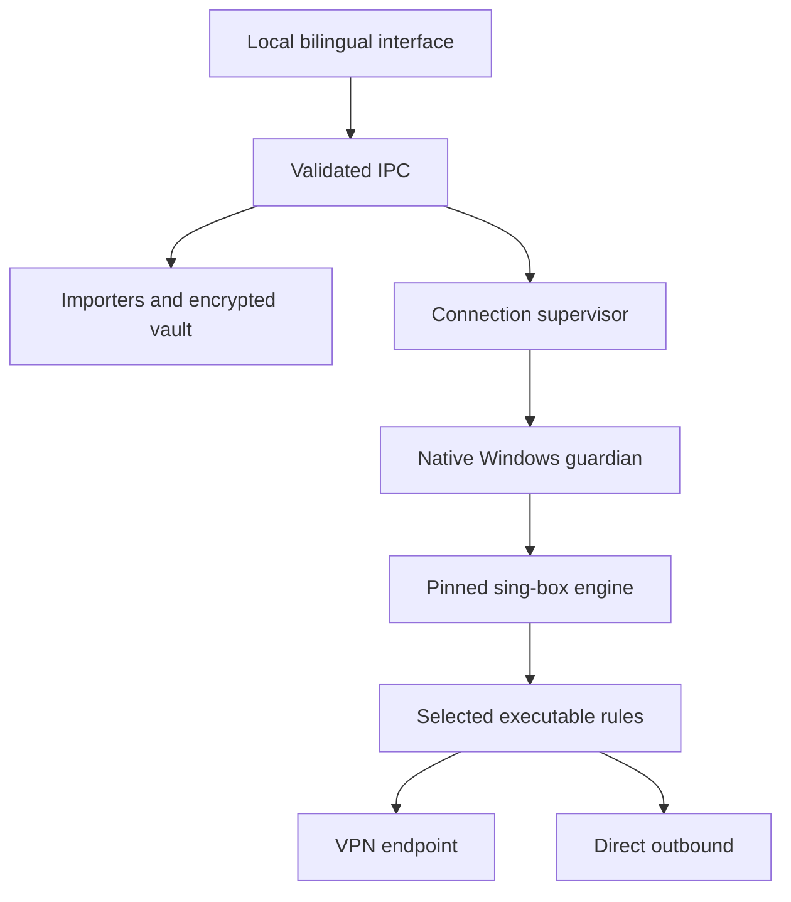

# Architecture · معماری

The Electron renderer is an offline view. Only the main process can read profiles, open native pickers, enumerate executables or start the managed engine. Profiles are normalized by protocol-specific parsers and encrypted by Electron safeStorage/Windows DPAPI.

`buildConfig` produces a fresh TUN configuration. It never executes user-supplied engine JSON. Selected-app mode has explicit process-path rules followed by direct routing. Entire-system mode uses the VPN as its default. DNS is intercepted and uses an explicitly documented tunnel/bootstrapping policy.

Before changing OS routes, the supervisor verifies binary hashes and runs the engine configuration checker. It launches the core under a Windows guardian. A successful core startup is followed by an outbound connectivity test; the UI does not call a running process a verified VPN connection. The guardian places the core inside a Job Object before resuming its thread, and observes the parent stdin pipe. A stop/EOF requests CTRL_BREAK, followed by forced job termination if needed. This is lifecycle management. The separate native network-lock helper installs persistent WFP filters when the optional Kill Switch is enabled. It arms once before startup and atomically refreshes with the actual TUN interface LUID after readiness. Stopping the core never removes those filters; explicit recovery does. Its own binary is integrity-checked before each invocation. A minimal automatic-start LocalService process supplies the WFP provider service association needed for persistent policy reload; it has no configuration IPC, vault access or network listener. Filtering changes remain in the elevated helper.

The Windows installer places the application in a machine installation directory and carries local assets and licenses. Application secrets live in the current Windows account’s private app-data directory. The UI is currently elevated along with the network supervisor; a separate privileged service is future work.

در این معماری، رابط محلی به سیستم‌فایل و اجرای دستور دسترسی مستقیم ندارد. ورود پروفایل، رمزگذاری، ساخت قوانین و اجرای موتور در بخش اصلی انجام می‌شوند. موتور از نسخهٔ مشخص دانلود و بررسی می‌شود؛ محافظ بومی ویندوز مدیریت طول‌عمر آن را بر عهده دارد.

The renderer receives only the sanitized connection diagnostic and summarized firewall status. No automatic diagnostic upload is implemented. Startup failure, control-API failure and outbound-probe failure are distinct; a child exit during the probe cannot transition into a connected state.

The recovery startup flag is processed before opening the DPAPI vault, so a broken or inaccessible vault does not prevent releasing application-owned filters. Uninstall releases the lock before removing the helper, and aborts without deleting files if recovery fails.
